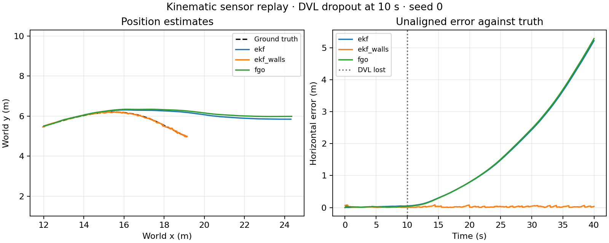

# AUV Navigation Fusion: Underwater State Estimation and Sensor Recovery

A standalone Python toolkit that estimates an underwater vehicle's position, velocity and heading from IMU, Doppler velocity log (DVL), depth, compass and mapped landmark observations. Optional sonar wall updates and a simulation-trained velocity model help the EKF continue through DVL outages.

The project answers one engineering question: **where is the vehicle, how is it moving, and how uncertain is that estimate when measurements degrade?** It accepts sensor records and returns estimates and diagnostics. Mission planning, object detection, guidance, motor control and sensor simulation belong to other components.

The estimation algorithms were developed within [Agentic AUV](https://github.com/MadLad10/Agentic-AUV-multimodal-multi-agent-autonomy-for-an-underwater-robot). This repository packages them with an independent measurement API, installed configuration/model resources, a log-replay CLI, tests and evaluation examples.

## What we built

- **An eight-state EKF:** world position/velocity, yaw and gyro-z bias; IMU propagation; DVL, compass, depth and mapped range/bearing updates; innovation gating and Joseph-form covariance updates.
- **A GTSAM/iSAM2 alternative:** IMU preintegration, pose/velocity/bias keyframes, depth, DVL, attitude and mapped-landmark factors with robust kernels on selected observations.
- **Known-map sonar corrections:** rectangular pool-wall range predictions, incidence filtering, object-return gating and scalar EKF corrections.
- **Learned velocity recovery:** a 40-sample GRU model runs in NumPy; optional DVL residuals estimate horizontal current before an outage. A bundled 22 KB simulation-trained artifact makes inference reproducible without PyTorch.
- **A measurement-driven integration layer:** per-sensor timestamps, duplicate suppression, explicit health exclusions, input validation and recovery scheduling without ROS or a mission backend.
- **Replay and evaluation tools:** JSONL input/output, estimates, unaligned errors against optional truth, deterministic noisy-sensor fixtures, plots and a trajectory-replay animation.

[Extraction provenance and implementation changes](docs/EXTRACTION.md). [Input/output contract](docs/INPUT_FORMAT.md).

## Technology stack

| Technology | Role |
|---|---|
| Python 3.10+ | Estimator APIs, scheduling, replay, CLI and evaluation |
| NumPy 1.x | EKF math, uncertainty propagation, geometry and GRU inference |
| PyYAML | Packaged defaults and experiment overrides |
| GTSAM 4.2, optional | Factor graphs, IMU preintegration and incremental iSAM2 optimization |
| Matplotlib / Pillow, optional | PNG/SVG plots and GIF trajectory replay |
| PyTorch, training tools only | Original GRU training recipe and numerical reference generation |
| pytest / setuptools / GitHub Actions | Tests, wheel/source distribution and configured CI |
| MuJoCo Marine Sim, optional | Independent physics/sensor integration example and test |

Core installation requires NumPy and PyYAML. The NumPy upper bound also keeps the optional GTSAM 4.2 path on the NumPy 1.x ABI. ROS 2, a simulator, a model server and PyTorch are unnecessary for inference or log replay.

## Sensor and measurement stack

| Input | Fields and frame | Use |
|---|---|---|
| IMU / AHRS | Timestamp; body gyro in rad/s; body specific force in m/s²; roll/pitch in radians | Position/velocity prediction and yaw/bias propagation |
| DVL | Timestamp, validity and body-frame ground velocity in m/s | Velocity correction when bottom lock is valid |
| Pressure-derived depth | Timestamp and depth in meters, positive down | Vertical position correction; learned-model depth-rate feature |
| Compass | Timestamp and yaw in radians | Heading correction |
| Imaging-sonar scan | Timestamp, validity, bearing/range arrays; explicit mounting offset, range limit and known wall rectangle | Optional EKF wall-map correction |
| Mapped landmark | Known world x/y, measured horizontal range/bearing and measurement uncertainty | Explicit landmark correction; detection/association is supplied by the caller |
| Thruster command telemetry | Six observed requests in N in the documented order | Input to the optional learned model; this library sends no commands |

The reference stream uses IMU 20 Hz, DVL 5 Hz, compass/depth 10 Hz and sonar 2 Hz. EKF prediction uses timestamps; the bundled GRU specifically expects a regular 20 Hz stream and six commands normalized by its training scale of 40 N. Coordinates use x/y in the horizontal plane and z upward; depth = −z.

The estimator uses generic measurement records rather than device-specific hardware drivers. [Exact fields, conventions and example log](docs/INPUT_FORMAT.md).

## Supported combinations

| Feature | EKF | Factor graph |
|---|---|---|
| IMU + DVL + compass + depth | Yes | Yes |
| Explicit mapped range/bearing landmarks | Yes | Yes |
| Known rectangular wall updates | Yes | Unsupported |
| Learned pseudo-velocity and current heuristic | Yes | Unsupported |

Unsupported combinations raise an error. In particular, the original factor-graph pseudo-velocity adapter reused DVL weighting and ignored the supplied prediction uncertainty; that path is explicitly disabled here. Default configuration uses sensor-only EKF. Known-map and learned recovery features are opt-in.

## Install

From this checkout, using uv:

```bash
uv venv --python python3 .venv
source .venv/bin/activate
uv pip install -e '.[dev,factor-graph,plot]'
```

For core inference only, install `.` without extras. Python venv/pip can also be used where available. There are no ROS overlay requirements.

## Quick start

```bash
auv-nav config
python examples/basic.py

# Generate analytic noisy-sensor traces and compare two EKF configurations.
auv-nav demo --seconds 40 --seeds 3 --plot --output runs/demo

# Add the optional factor-graph baseline.
auv-nav demo --seconds 40 --seeds 3 --estimators ekf,ekf_walls,fgo \
  --plot --output runs/demo_with_fgo
```

Each demo saves traces, per-run metrics, a summary with seeds/settings/input checksums, and optional PNG/SVG/GIF media. This demo is a **kinematic sensor replay** generated from analytic trajectories and noise. It does not run a vehicle controller or MuJoCo dynamics.

Replay an existing trace, including `sensors.jsonl` from Marine Sim:

```bash
auv-nav replay path/to/sensors.jsonl --initial-position 0 0 -0.3 \
  --initial-yaw 0 --output runs/replay
```

For the generated fixture, supply its known starting pose and map:

```bash
auv-nav replay runs/demo/dvl_dropout_seed0.jsonl \
  --initial-position 12 5.5 -1.5 --initial-yaw 0.4 \
  --wall-map -5 25 -10 10 --output runs/replay_walls
```

The caller supplies initial pose and any map/calibration. Replay uses truth only after estimating a state to compute errors. Traces without truth still produce estimates and diagnostics. Choose an empty output directory for each run.

## Python API

```python
from auv_navigation_fusion import NavigationFusion

nav = NavigationFusion(x0=(0, 0, -1.5))
state = nav.update({
    'imu': {'t': 0, 'gyro': [0, 0, 0], 'accel': [0, 0, 9.81],
            'roll': 0, 'pitch': 0},
    'dvl': {'t': 0, 'valid': True, 'vel': [0, 0, 0]},
    'pressure': {'t': 0, 'depth': 1.5},
    'compass': {'t': 0, 'yaw': 0},
})
print(state)
print(nav.summary())
```

`NavEKF` and optional `FactorGraphNav` also expose their lower-level predict/update methods. The wrapper's `blocked` argument lets a separate health policy exclude an untrusted sensor. It performs no fault diagnosis itself.

## Results and recorded media



[Trajectory animation](docs/media/dvl_dropout.gif). These are fresh kinematic replay outputs, with no rigid-body simulation or motor controller.

Across three seeds and 40 seconds per trace, mean horizontal RMSE (m), reported as mean ± population standard deviation:

| Fresh replay condition | EKF | EKF + wall ranges | FGO |
|---|---|---|---|
| Nominal | 0.055 ± 0.022 | 0.013 ± 0.001 | 0.066 ± 0.024 |
| DVL lost at 10 s | 2.067 ± 0.180 | 0.027 ± 0.002 | 2.038 ± 0.137 |

The fixture includes a fixed accelerometer offset and idealized wall echoes from an accurate known rectangle. Both sensor-only filters drift after DVL loss. The wall-assisted result measures the value of that supplied map in this fixture. [Fresh metrics and settings](docs/fresh_replay_summary.json).

[Evaluation guide](docs/RESULTS.md) separates fresh standalone replay results from imported integrated-system studies. Those experiments use different motion, sensor and task conditions and should be read separately.

The imported fusion study contains 400 integrated mission runs, with 20 seeds for each condition/configuration. Mean horizontal RMSE in meters:

| Historical condition | EKF | + wall ranges | + learned/current | + walls + learned/current |
|---|---|---|---|---|
| DVL dropout | 0.771 | 0.238 | 0.222 | 0.129 |
| DVL dropout with current | 0.793 | 0.159 | 0.646 | 0.584 |
| Compass + DVL loss, long holds | 35.864 | 3.651 | 2.520 | 0.445 |

These values are retained historical application results, not reruns of this standalone release. Wall ranges alone outperform the full recovery stack in the current condition. The original training distribution and current-estimation warm-up matter. [Imported rows and original report](docs/historical/nav_study_fusion/summary.md).

Two additional imported studies cover current recovery and EKF/factor-graph comparisons. Their artifacts and file checksums are preserved with the extraction provenance; exact original experiment revisions were not recorded in those files.

## Optional simulator integration

Install the separately built simulator wheel into this environment, then run:

```bash
uv pip install ../mujoco_marine_sim/dist/mujoco_marine_sim-0.1.0-py3-none-any.whl
python examples/passive_simulator.py
```

This example estimates state during passive buoyancy-driven motion and records localization error against simulator truth. It issues zero motor commands. The simulator source is maintained in its own repository.

## Learned model and training

The bundled model uses a two-second history of gyro, acceleration, roll/pitch, six observed commands and depth rate. Its original training recipe is in [training/train_dvl_net.py](training/train_dvl_net.py); PyTorch is needed only to train a replacement. Input NPZ datasets contain `X` (N × 15 features), `Y` (N × 3 body velocity) and `episode` IDs. Training and validation must use separate trajectories.

The original model was trained on simulator ground velocity under still-water conditions. Current recovery treats its output as a still-water motion prior and low-pass filters the DVL residual. This is a vehicle-specific heuristic, not a direct measurement of water velocity. The original held-out synthetic validation metrics are bundled with the model and do not establish accuracy on another vehicle or in real water.

## Tests and packaging

```bash
python -m pytest -q
uv build
```

Tests cover static/dynamic estimation, coordinate transforms, uncertainty growth, innovation gating, timestamp handling, malformed data, truth isolation, map correction, GRU numerical parity, current recovery, CLI behavior and optional GTSAM/simulator integration. [Verification receipt](docs/verification.json) records the checks actually executed. The GitHub Actions workflow is provided separately; local validation does not imply remote CI has run.

## Repository layout

```text
src/auv_navigation_fusion/   estimators, scheduling, geometry, replay and CLI
  config/                   installed defaults
  models/                   simulation-trained GRU and original validation metrics
examples/                   API and optional passive simulator examples
training/                   original GRU training recipe
tests/                      estimator, recovery, input-contract and integration checks
docs/                       provenance, results, media and imported historical studies
```

## Limits

This is an extraction of established estimation techniques. The known-wall method assumes an accurate rectangular map. EKF roll/pitch are supplied AHRS observations; the EKF estimates yaw and gyro-z bias rather than a full orientation/bias state. Factor-graph uncertainty reports use its latest keyframe covariance. The replay layer is intended for ordered sensor snapshots and provides no out-of-sequence smoothing.

Sensor noise, the bundled learned model and all imported studies come from simulation. The package has no real-water validation. A supplied map, initial pose or landmark association is an explicit prior; simulator truth is an evaluation field.

## License

MIT. Dependencies retain their respective licenses.
